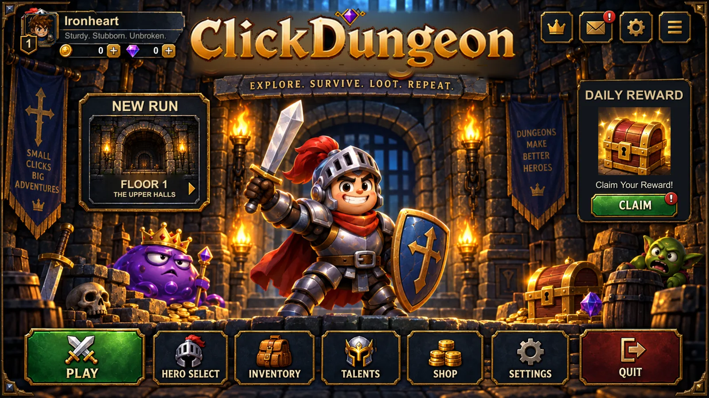
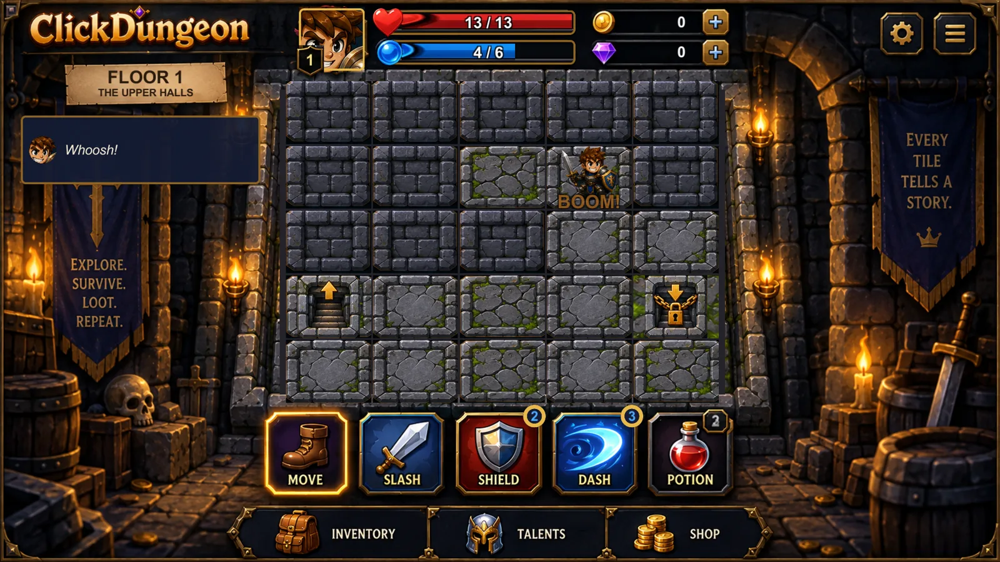
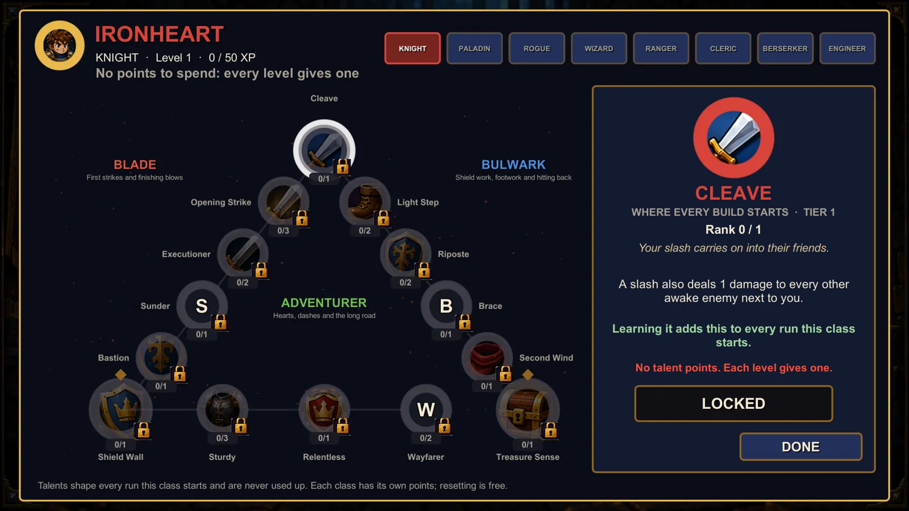
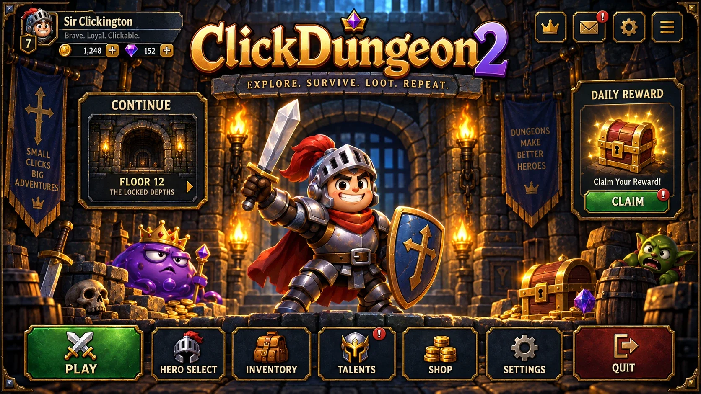
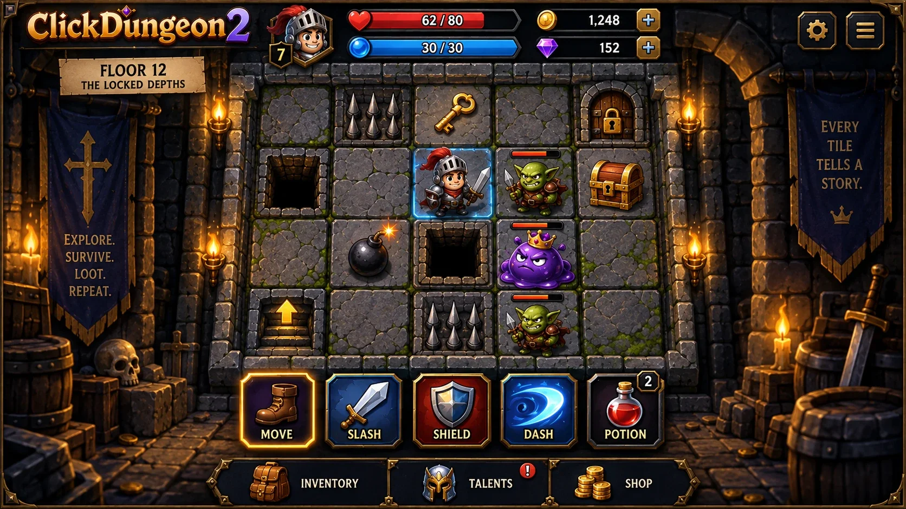
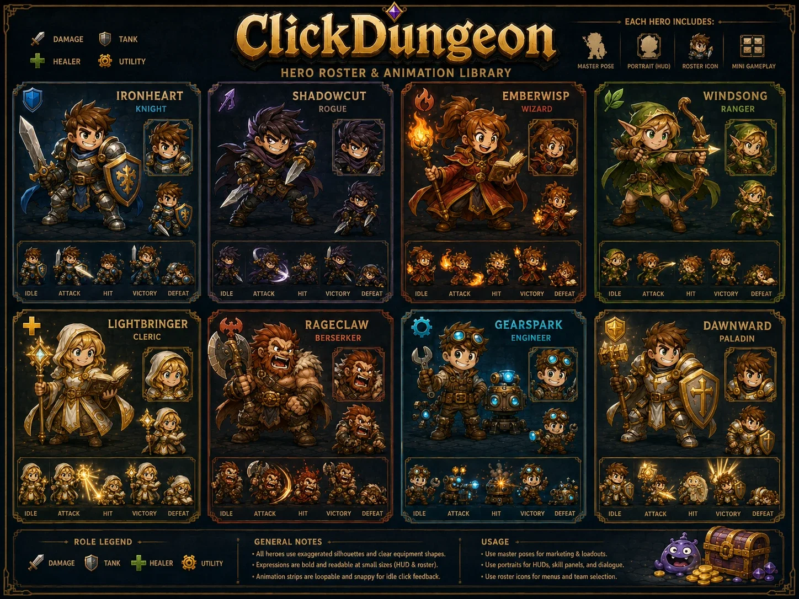
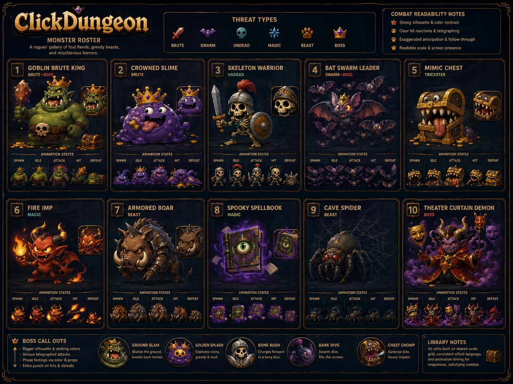
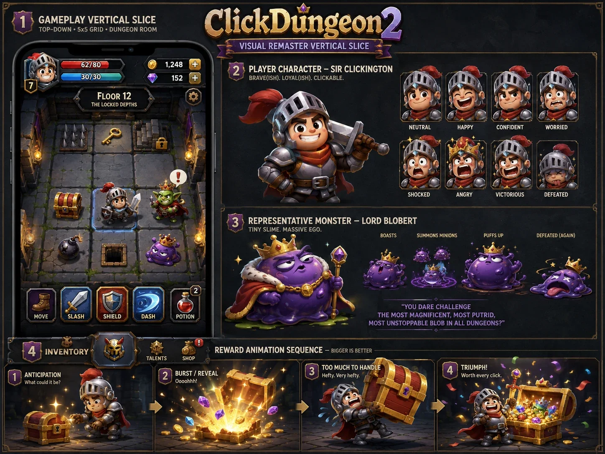

# ClickDungeon

A compact, turn-based 5×5 dungeon crawler. Read the dungeon, take calculated risks, survive the consequences.

**Current stage: Gate 2 — fun test, with the art pipeline running alongside.** See `docs/checklist.md`.

Twenty floors in acts, nine heroes across eight classes, branching talent trees, usable skills, equipment,
shops and a Phoenix Feather you can carry. Builds for Windows, Android and iOS.



## The current build

Every monster telegraphs its blow a turn before it lands, so a loss is always something you could have read.
A floor starts covered: you click tiles to find out what is on them, find the key, and reach the exit before the
board wears you down. Four acts of five floors, with a boss on every fifth.

| | |
|---|---|
|  |  |
| **A floor in progress.** Covered tiles, the locked exit, and the action bar: Move, Slash, Shield, Dash, Potion. | **Talents.** Each class has its own tree: two roads and a shared rail, 112 talents and 40 skills across the eight. A committed build unlocks three skills and the bar holds two. |

Screenshots are taken from `ClickDungeon/Builds/Windows` at commit `100f2b8` with the automation flags below.

## Concept art

The reference sheets the build is being made against. Some carry a "ClickDungeon 2" logo from the
visual-remaster brief; the art in the game is sliced from these (`tools/art-slicer/`) until the real art lands.

| | |
|---|---|
|  |  |
| Title screen | Gameplay |
|  |  |
| Hero roster: the eight classes, with idle / attack / hit / victory / defeat strips | Monster roster: ten monsters, threat types and boss call-outs |


*Vertical slice: the phone layout, Sir Clickington's expressions, Lord Blobert, and the reward sequence.*

## Layout

| Path | What |
|------|------|
| `docs/rules.md` | Gate 0 rules lock. The single source of gameplay truth. |
| `docs/decisions.md` | High-reversal-cost decisions (DECISION / WHY / DEPENDENCIES / REVERSIBILITY). |
| `docs/checklist.md` | Gate progress and Gate 2 watch list. |
| `docs/images/` | README screenshots and concept art. |
| `ClickDungeon/` | Unity 6 project (6000.5.9f1). |
| `ClickDungeon/Assets/ClickDungeon/Scripts/Domain` | Runtime state, grid, enums. Pure C#. |
| `.../Content` | Content definitions and the default catalog (ids, stats, templates, floor profiles). |
| `.../Simulation` | Rules: turn resolver, visibility, AI, combat, hazards, chests, generation, validation. |
| `.../Application` | `GameSession`, JSON saves with atomic writes. |
| `.../Unity` | Presentation only: screens, board view, input, programmer art. |
| `.../Editor` | Scene/build setup (`ClickDungeon` menu). |
| `.../Tests` | NUnit rule tests; run in Unity *and* headless. |
| `Sim/ClickDungeon.Sim.Tests` | Headless dotnet test project compiling the same sources. |

Dependency direction: `Domain → Content → Simulation → Application → Unity`. Nothing below `Unity` references `UnityEngine`.

## Run the rules tests (no Unity needed)

```bash
dotnet test Sim/ClickDungeon.Sim.Tests/ClickDungeon.Sim.Tests.csproj
```

## Open and play

1. Open `ClickDungeon/` in Unity 6000.5.9f1.
2. Open `Assets/ClickDungeon/Scenes/Main.unity` (or run **ClickDungeon → Rebuild Main Scene**).
3. Press Play.

Build Windows: **ClickDungeon → Build Windows** → `ClickDungeon/Builds/Windows/ClickDungeon.exe`.
Also **Build Android** (`Builds/Android/ClickDungeon.apk`) and **Build iOS** (`Builds/iOS`, an Xcode project).
Every build writes `BUILD-VERSION.txt` with the commit it came from, so a kit can never claim a tree it was not
built from.

## The gates

Three suites stand between a change and a playtest kit, and `make-kit.ps1` runs all three before it packages
anything:

| Suite | What | Where |
|---|---|---|
| Headless | the whole rule set, no Unity | `dotnet test Sim/ClickDungeon.Sim.Tests` |
| EditMode | screens, art keys, catalog wiring | `tools/playtest-kit/unity-gate.ps1 -Platform EditMode` |
| PlayMode | the scene boots and plays | `tools/playtest-kit/unity-gate.ps1 -Platform PlayMode` |

Two of the headless tests are balance guards rather than rule tests: an autoplay bot plays every class build
over hundreds of seeded runs, and their floors are set from measured tables with explicit sigma margins. They
are slow on purpose — a guard with no margin goes red on noise and teaches you to ignore it.

### Controls

- **Free Roam** (default): tap any tile on the board to step there, tap an adjacent enemy to slash it, or tap a
  chest on or beside you to work it open. Tap the hero to wait. Unrevealed tiles are blank covers with no hints —
  clicking is how you find out what is on them.
- **Step by Step** (option, **Settings → MOVEMENT**): the same, except you can only move to one of the eight neighbouring
  tiles, and sensing marks nearby tiles with a clue. The setting applies to your next new run.
- Chests take several taps to open — Common 2, Rare 3, Epic 4 — and every tap is a turn the monsters answer.
- SLASH / DASH buttons select a target mode; SHIELD / POTION act immediately.
- Keyboard: WASD/arrows, Space wait, 1–5 abilities, Esc menu/back, H help.

### Automation screenshot (dev)

```bash
ClickDungeon/Builds/Windows/ClickDungeon.exe -cdShot shot.png -cdScreen game -cdSeed 42 -cdTurns 6
```

Uses a separate save folder and quits after capturing.

Bot flags: `-cdBot smart|casual|random`, plus `-cdBlind 1` to make the bot decide on what the player can see
rather than the whole board — without it the bot walks straight to a key it should not know about (D-021).
Also `-cdDifficulty easy|medium|hardcore`, `-cdMovement free|step`, `-cdOverlay <name>` and `-cdTelemetryDir <folder>`.

## Playtest telemetry (Gate 2)

Runs write local JSONL logs (no network) to `%USERPROFILE%\AppData\LocalLow\Clickd\ClickDungeon\telemetry`.
Turn them off in **Settings → PLAYTEST LOG**. Schema and metrics: `docs/telemetry.md`.

```bash
dotnet run --project Sim/ClickDungeon.Telemetry.Report -- "%USERPROFILE%\AppData\LocalLow\Clickd\ClickDungeon\telemetry"
```

In Unity: **ClickDungeon → Telemetry → Summarize Logs**.

### Playtest kit

```bash
powershell -ExecutionPolicy Bypass -File tools/playtest-kit/make-kit.ps1
```

Zips the Windows build with a tester README and `collect-logs.bat` into `ClickDungeon/Builds/Playtest/`.
Session plan, interview questions and decision criteria: `docs/playtest-guide.md`.

## Art

Brief (reference images, specs, deliverables, decisions): `docs/art-brief.md`.
Drop PNGs into `ClickDungeon/Assets/ClickDungeon/Art/Runtime/` named by key (e.g. `tile_spikes.png`);
anything missing keeps its placeholder. **ClickDungeon → Art → Report Art Coverage** lists what's done.

### Stand-in icons (D-089)

Growing the trees added 24 talents and 16 skills, and none of them had art. Rather than ship blank buttons,
each took a picture already in the repository, and every one is a **placeholder waiting to be replaced**:

- Eight of the new talents use the icons orphaned when D-087 deleted their owners — real paintings, same class,
  otherwise unused (`k_fortune` → Wayfarer, `p_guiding_light` → Pilgrim, `c_smite` → Castigate, and five more).
- The other sixteen talents and all sixteen skills reuse the icon of a node sharing their effect, so several
  nodes currently show the same picture.
- The three new status pips — Siphon, Fortify, Hold — point at unused status art that already fitted: a drain,
  a raised guard, and being frozen in place.

`tools/art-slicer/slice_references.py` is how real art gets in: add a rect to `slices.json` against a reference
sheet, slice, then **ClickDungeon → Art → Rebuild Art Catalog**.
